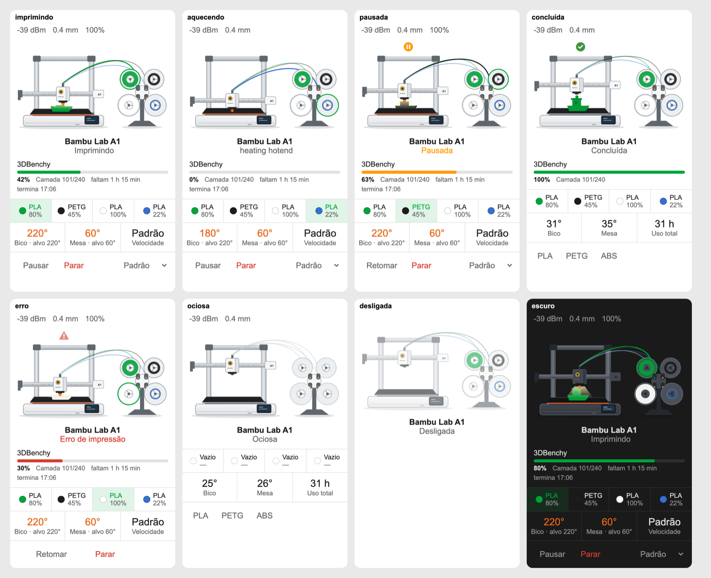

# Bambu Lab A1 Card

[](https://hacs.xyz)
[](https://github.com/hudsonbrendon/bambu-a1-card/releases)
[](https://github.com/hudsonbrendon/bambu-a1-card/actions/workflows/lint.yml)

Animated Lovelace card for the **Bambu Lab A1** and its **AMS lite**, through
the [`bambulab_local`](https://github.com/hudsonbrendon/ha-bambulab-local) or
the [`bambu_lab`](https://github.com/greghesp/ha-bambulab) integration. Same
layout and minimal grey/white drawing as the vacuum, HP printer and MiSTer
cards.



- **Illustration**: the A1 redrawn after the product photos (white base, black
  textured plate, aluminium arch with grey caps, X beam with the white toolhead
  and its gold cutter knob, touchscreen) and the AMS lite next to it (four
  spools in an X around the hub on its stand, PTFE tubes arching to the
  toolhead). Each spool shows its **real filament colour** and how much is
  **left** (the wound filament shrinks); the active spool turns and its tube is
  lit.
- **States**: printing (the toolhead shuttles, the bed slings, the part grows in
  the active filament colour and the gantry rises with it), preparing (stage in
  the status: heating, leveling...), paused, error / failed (warning), finished
  (check), idle, offline, unavailable. Hot nozzle glows, hot bed shimmers, the
  toolhead LED lights the plate.
- **Job**: cover image, task name, progress bar, layer `n/total`, time left and
  end time.
- **AMS slots**: colour, material and remaining % per slot (+ external spool
  when loaded); the active slot is highlighted.
- **Stats**: nozzle and bed temperature with their target and **−/+** to change
  it, speed profile while printing, total use when idle.
- **Toolbar**: pause / resume, stop (with confirmation), clear error, chamber
  light, speed profile (Silent / Standard / Sport / Ludicrous), cool down, home,
  bed leveling (with confirmation) and your own shortcuts (preheat scripts...).
- **Tips**: Wi-Fi signal, nozzle diameter, part fan, HMS errors, firmware
  update.
- Entities are found by the integrations' `translation_key`, so it works in
  any Home Assistant language. Visual editor, entity suggestion, en + pt-BR,
  dark mode, `prefers-reduced-motion`.

## Install

HACS → Frontend → ⋮ → *Custom repositories* → add
`https://github.com/hudsonbrendon/bambu-a1-card` as *Dashboard*, then install
**Bambu Lab A1 Card**. Manual: copy `dist/bambu-a1-card.js` to `/config/www/`
and add it as a JavaScript module resource.

## Configuration

```yaml
type: custom:bambu-a1-card
device: <printer device id>   # pick it in the visual editor
# name: Bambu Lab A1
# temperature_step: 5         # °C per −/+ press
# entities:                   # optional overrides, by card key
#   cover: image.bambu_a1_cover_image
shortcuts:
  - name: PLA
    icon: mdi:printer-3d-nozzle-heat
    service: script.bambu_a1_pre_aquecer_pla
  - name: PETG
    icon: mdi:printer-3d-nozzle-heat
    service: script.bambu_a1_pre_aquecer_petg
```

The AMS lite and external spool are separate devices; the card finds them
through the device registry (same config entry or `via_device`).

| Option | Default | Description |
| --- | --- | --- |
| `device` | — | Printer device id (`bambulab_local` or `bambu_lab`). |
| `entities` | — | Overrides per card key (handy to mix both integrations). |
| `name` | device name | Title under the illustration. |
| `show_name` / `show_status` / `show_ams` / `show_toolbar` | `true` | Toggle sections. |
| `compact_view` | `false` | Hide the illustration, job and stats. |
| `temperature_step` | `5` | °C per −/+ press on the nozzle / bed target. |
| `shortcuts` | `[]` | Extra idle buttons `{ name, icon, service, service_data, target }`. |
| `language` | HA language | Force `en` or `pt-BR`. |

Card keys: `online`, `print_status`, `stage`, `progress`, `remaining`,
`end_time`, `layer`, `total_layers`, `nozzle_temp`, `nozzle_target`,
`bed_temp`, `bed_target`, `part_fan`, `speed`, `speed_profile`, `light`,
`task`, `cover`, `camera`, `hms`, `print_error`, `wifi`, `nozzle_size`,
`total_hours`, `firmware`, `pause`, `resume`, `stop`, `clear_error`, `home`,
`cooldown`, `bed_level`, `external_spool`, `tray_1` … `tray_4`.

Tapping the printer opens the camera; tapping a slot, a stat or a tip opens
that entity.

## Development

```bash
npm install
npm test && npm run lint && npm run typecheck
npm run build   # dist/bambu-a1-card.js
```

## License

MIT
